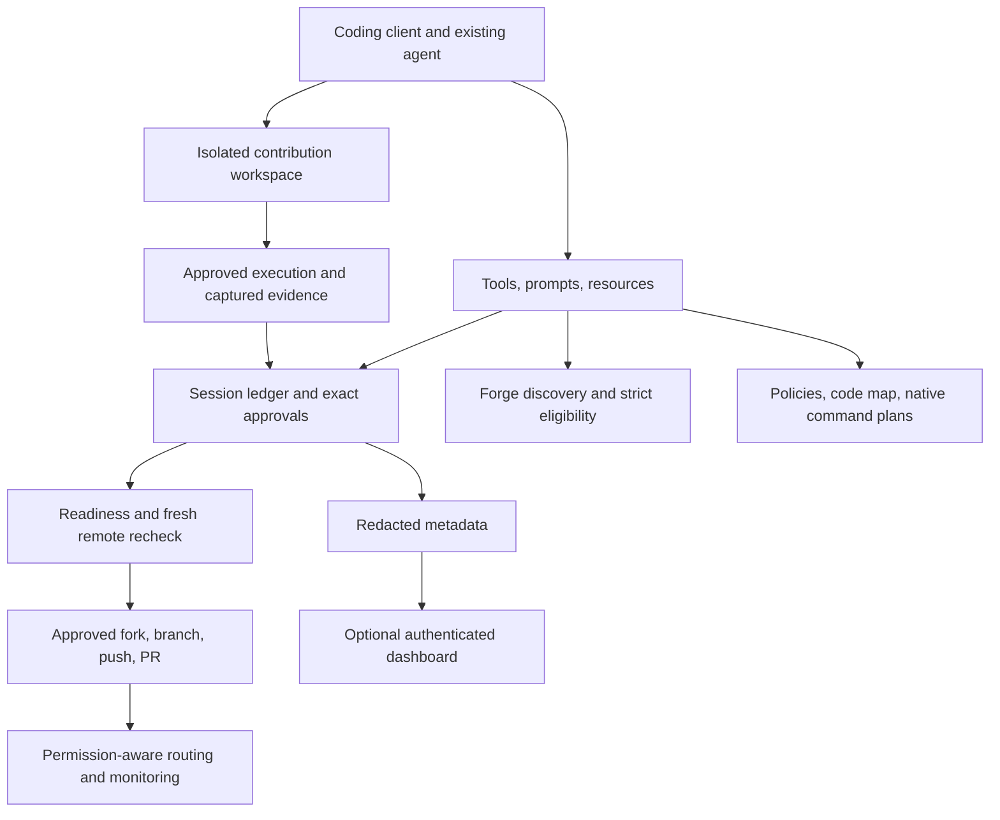

# Architecture

The local MCP application is the contribution authority. `createApplication` composes 21 Zod-validated tools and six workflow prompts around a private SQLite store. STDIO uses the pinned official MCP SDK when installed, or an explicitly reported legacy compatibility transport. The server supplies bounded observations and a next action; the host agent performs reasoning, editing, and independent critique. No model API or second agent service is called.

`src/core/models.ts` versions the domain contracts. Session mutations use SQLite transactions and revision checks. Events record state changes, tool timing/errors, command results, approvals and publication stages. Artifacts are atomically replaced; captured command output and tested patches have SHA-256 identities. Cached observations remain dated evidence. Publication requires fresh remote reads rather than trusting discovery caches.

Discovery combines repository and issue searches, health observations, author privilege/roster evidence, REST/GraphQL timelines, PR search and advisory similarity. Hard gates run before the six weighted ranking dimensions. Incomplete scans and unknown provenance remain unresolved. Search budgets bound requests and time. The author-association string alone does not prove maintainership.

Policy sources are pinned to repository revisions. The analyzer reads repository/org guidance, agent instructions, templates, CODEOWNERS, workflows and manifests, then maps relevant modules and nearby tests. Scoped indexing and revision/overlay caches limit context. Reproduction notes and semantic root-cause analysis come from the host with explicit evidence references. Project text never grants permissions.

Language adapters plan environments and argument-array commands. The generic fallback accepts safe, simple repository-documented commands. Host-approved execution strips ambient credentials, captures output and exit status, bounds time/output, and checks whether commands changed the tested patch. It requires an external sandbox; it is not a filesystem or network isolation mechanism. Trusted extension adapters are a separate executable-code trust decision with a pinned entry-module hash.

The publisher binds the exact proposal and complete file comparison to an expiring human grant. Durable publication intents, leases, deterministic native commits and remote reconciliation protect retries. No force push or automatic merge exists. Review requests require verified reviewers, permissions and separate consent. Revision implementation and public updates use distinct grants. Webhooks only invalidate cached decisions and approvals; they do not launch public actions.

The optional HTTP service authenticates hashed scoped tokens and HttpOnly browser cookies, checks origin/Host/CSRF, and namespaces tenant metadata. Synced summaries are explicitly source-reported data; they cannot create execution evidence or approval grants. The dashboard reports actual observed stages and outcomes, including negative incident counts.
