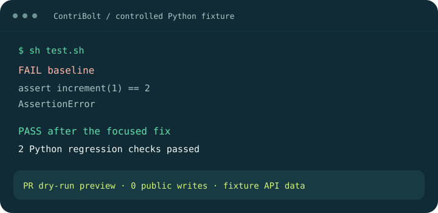

# From a verified issue to a PR preview

This is an **illustrative walkthrough of a controlled, executable fixture**. The repository/issue data is synthetic and forge responses are mocked. The source edit, failing/passing Python commands, patch inspection and PR dry-run preview use the real application. No live issue, model conversation, public PR, or maintainer endorsement is implied.



## 1. The initial request

> Find me an open-source contribution in Python. Choose a small fix, and keep this a dry run.

In a live client, the host calls `start_contribution` and collects language, challenge level and repository preference. In the fixture, those preferences are supplied directly with `dryRun: true`. The server returns a next action; the existing coding agent performs reasoning and source edits.

## 2. Discovery and selection

The fixture presents two public repositories with an open “Increment returns unchanged value” issue. Author evidence identifies the repository owner; discussion count is zero, there are no assignees, and the controlled linked/competing-work and reservation scans complete without conflicts. Contribution guidance permits a focused PR.

These are the same strict gates used for live discovery. A search hit alone is not enough. A missing permission or incomplete scan would remain unresolved rather than become an eligible match. See [feature status](feature-status.md).

## 3. Repository analysis

The real analyzer reads the temporary repository's contribution rules and relevant files:

```text
CONTRIBUTING.md  Focused tests and pull requests are welcome.
subject.py       The increment function returns its input.
test.py          Checks increment(1) == 2 and increment(0) == 1.
test.sh          Runs the Python regression check.
```

The recorded analysis describes expected/actual behavior, the missing addition, and a minimal plan. The fixture test harness supplies those semantic observations and performs the edit, taking the role that a coding agent has in a live session.

## 4. A focused fix

```diff
 def increment(value):
-    return value
+    return value + 1
```

The regression script already covers the behavior; the fixture does not invent a new test or claim a broad test suite. A real issue may need a new focused regression case.

## 5. Actual validation

Both executions use the application's evidence wrapper and the native `sh test.sh` command. The baseline fails:

```text
assert increment(1) == 2
AssertionError
```

After the fix, exit code is zero and output is:

```text
2 Python regression checks passed
```

[demo-evidence.json](assets/demo-evidence.json) contains the captured status, exit code, output and hashes. [demo-transcript.txt](assets/demo-transcript.txt) is a real test capture with ANSI color removed and the project path normalized. Its duration is an observation, not a performance benchmark.

## 6. PR preparation and developer control

The fixture records an independent diff critique and prepares the title **Correct increment behavior**. The production proposal builder includes the focused strategy, changed files, recorded checks and issue reference. It then exercises `publish_pull_request` in dry-run mode and verifies that the result is a preview and **public writes remain zero**.

The PR body structure is:

```text
Summary      Add the missing increment with focused regression coverage.
Changes      subject.py
Testing      Recorded native regression: PASS
Reference    The fixture's selected issue
```

This is a readable outline, not a captured live PR or an exact serialized proposal. Applicable project templates and disclosures take precedence in real contributions.

For a real submission, begin a contribution with `dryRun: false`, review the complete proposal and its limitations, request approval, and confirm it in your trusted interactive terminal using the same private data directory. The server refreshes remote eligibility and validates the exact approved patch before a write. Reviewer requests, comments and revision updates use separate grants. Nothing merges automatically.

## Reproduce the controlled demonstration

With source access, Node and development dependencies, plus `sh`, Python and Git:

```sh
npm ci
npm run build
python3 scripts/capture-demo.py
python3 scripts/brand-assets.py --png
```

The first capture runs only the controlled Python dry run and fails if the expected failing baseline, passing fix, or zero-write assertion is missing. PNG rendering uses optional ImageMagick; SVG generation needs only Python. Do not treat the other filtered/skipped test cases in that targeted transcript as a full suite result.

For transport behavior without forge credentials:

```sh
python3 scripts/smoke-stdio.py
```

It reports its actual transport and checks 21 tools, six prompts, session resources, onboarding defaults, approval denial and stop/resume. Use `--require-sdk` and `--require-sdk --modern` to require the official SDK. An offline compatibility pass is not an official-SDK qualification.

## Capture a real demonstration

Use your normal terminal/desktop recorder on a contributor-controlled repository and an approved client. Record the initial request, actual dated issue evidence, scoped instructions, the focused diff, native command output and the PR preview. Keep the fixture label visible if any inputs are synthetic. Do not show a public submission without permission and the normal exact approval gate.

Review the recording for credentials, private paths, account information and unrelated repository content before sharing it. Keep a copy of the unedited check output privately so excerpts remain traceable. The [launch storyboard](launch-kit.md#30-second-demo-storyboard) is a proposed edit sequence, not a video that has already been recorded.
